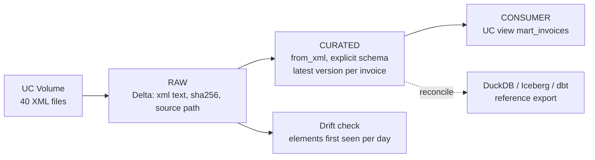

# xml-drift-lakehouse on Databricks

The same 40 XML invoice files (`data/daily`, 25 distinct invoices) processed with Spark and Delta Lake in Unity Catalog, then reconciled against the DuckDB / Iceberg / dbt result.

The point of this part of the project is a like-for-like comparison: same input, two engines, and a check that they agree.



## Result

| Check | Databricks | DuckDB / Iceberg / dbt |
|---|---|---|
| Distinct invoices | 25 | 25 |
| Current line items | 147 | 147 |
| Per-invoice comparison (11 checks: key, variant, winning file, workflow state, header total, line count, sum of line totals, md5 of line keys) | 0 differences | reference |
| `mart_invoices` aggregates (9 variant/year groups: rows, invoices, sums, approved, cost-center count) | identical | reference |

Surrogate keys are the same on both sides (first 16 hex characters of `sha256` over `invoice_id` or `invoice_id|line_number`), which is what makes a row-level comparison possible.

## What is in the notebook

`notebooks/xml_drift_lakehouse.py` (Databricks source format, import it into a workspace and run all):

| Section | What it does |
|---|---|
| 0. Setup | Creates schema `workspace.xml_drift` and a volume, unzips the sample files into it (staging only, see below) |
| 1. Raw | Each file stored untouched in a Delta table with a content hash and source path. `MERGE` on (path, hash): running it again adds nothing |
| 2. Curated | `from_xml` applies an explicit superset schema of both XML variants at read time. Latest version per invoice by `action_datetime`, then `ingested_at`, then `source_path` (ADR-0002). Managed Delta tables |
| 3. Reconciliation | Per-invoice comparison with the DuckDB export |
| 4. Consumer | Unity Catalog view with the dbt mart's derived metrics |
| 5. Drift | Elements first seen after day 1: `OriginalSystem` on day 2, `InvoiceAmount` on day 4 |
| 6. Delta | `DESCRIBE HISTORY` and time travel on the raw table |

## Run it

1. Create a Databricks Free Edition workspace (serverless compute, Unity Catalog). The notebook was run on serverless environment version 6.
2. Build the upload files on your machine:
   ```bash
   python databricks/make_landing_zip.py            # output/daily_xml.zip
   bash scripts/replay_daily.sh                     # Iceberg tables, needed for the reference export
   python databricks/export_duckdb_reference.py     # output/reconcile_duckdb.csv
   ```
3. In the workspace, run section 0 once to create the volume `workspace.xml_drift.landing`, then upload `daily_xml.zip` and `reconcile_duckdb.csv` to it (Catalog > workspace > xml_drift > landing > Upload to this volume).
4. Run all. Without the CSV the reconciliation cell prints a message and skips.

The zip exists because the Free Edition upload dialog takes single files, not folders. In a real setup the files would land in the volume (or cloud storage) directly from the source system or a CLI copy, and the pipeline would start at section 1.

## Findings

- **Same keys, same winners.** The latest-version rule from ADR-0002 ports to a window function unchanged, and picks the same file for every invoice.
- **Paths differ, so version keys differ.** Spark reports `source_path` as `dbfs:/Volumes/...`, the Python parser stores a relative path. `version_sk` (which hashes the path) is therefore not comparable, and the reconciliation uses the invoice key, line keys and file name instead.
- **Tie-break behavior.** All files arrive in one load here, so `ingested_at` ties and `source_path` decides between deliveries of identical content. In the Iceberg flow each day is a separate load. The result is the same on this data.
- **Drift fingerprints are noisy.** Hashing each file's element set gives almost one structure per file, because optional elements vary. Reporting elements first seen after a baseline day is the usable signal.
- **Schema subset.** The Spark schema captures identity, totals, workflow, vendor/client, line economics and allocation. The dbt mart has more columns (tax, early payment, cross reference) that are not ported.

## Not in scope

What I would add for production on Databricks: Auto Loader for incremental file discovery, Lakeflow Declarative Pipelines with expectations instead of hand-written checks, an incremental `MERGE` into curated instead of a rebuild, Jobs for scheduling and alerting, Databricks Asset Bundles with CI, and Unity Catalog grants per layer.

## Honest scope note

A small project built on the free tier to work hands-on with the platform: Unity Catalog, Delta, `from_xml`, serverless notebooks. It is not production experience on Databricks. The underlying pattern (raw / curated / consumer, schema-on-read over XML that changes over time) is the one I run at scale on AWS with Glue and Athena.
